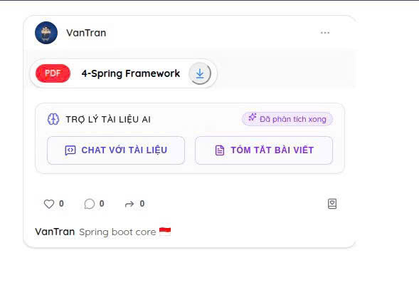
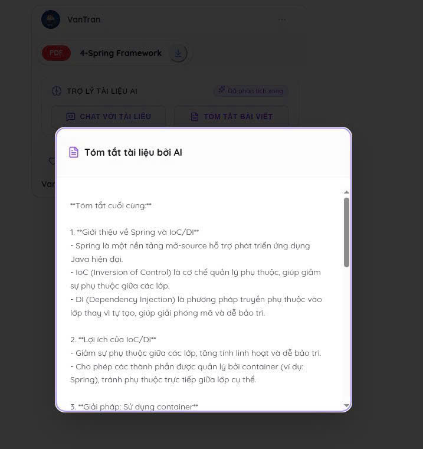
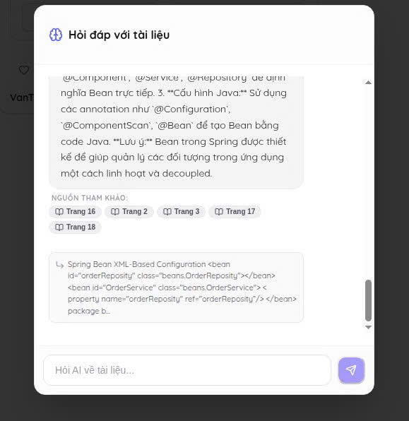
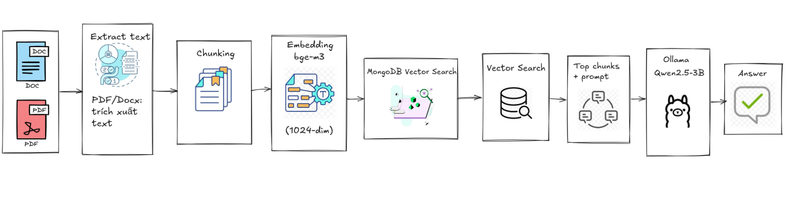

# Social Learn AI Service

An AI microservice for a social learning platform. It indexes learning materials and provides document summaries and source-grounded chat responses.

## Features

- Index PDF, DOCX, and image documents from a URL.
- Extract text with PyMuPDF, python-docx, and Tesseract OCR.
- Create multilingual embeddings with BGE-M3 and store them in MongoDB.
- Retrieve relevant passages through MongoDB Vector Search.
- Generate summaries and RAG-based answers with Qwen running on Ollama.

<p align="center">
  
</p>

<p align="center">
  
  
</p>

## Architecture

<p align="center">
  
</p>

## Stack

- FastAPI
- MongoDB and MongoDB Vector Search
- BAAI/bge-m3 embeddings
- Qwen2.5 via Ollama
- Docker Compose

## Quick Start

Create the environment file and set your MongoDB connection string:

```bash
cp .env.example .env
```

Start the service and Ollama:

```bash
docker compose up -d --build
```

The API is available at `http://localhost:8000`; verify it with:

```bash
curl http://localhost:8000/health
```

If the host does not have an NVIDIA GPU, remove `gpus: all` from the `ollama` service in `docker-compose.yml`.

## Required Configuration

```env
MONGO_URI=mongodb://localhost:27017
MONGO_DB_NAME=social_learn_ai
MONGO_VECTOR_INDEX_NAME=document_vector_index
EMBEDDING_MODEL=BAAI/bge-m3
EMBEDDING_DIM=1024
OLLAMA_BASE_URL=http://ollama:11434
QWEN_MODEL=qwen2.5:3b
```

When running the API outside Docker, set `OLLAMA_BASE_URL` to `http://localhost:11434`.

## MongoDB Vector Search Index

Create this index on the `document_chunks` collection. Its name must match `MONGO_VECTOR_INDEX_NAME`.

```json
{
  "fields": [
    {
      "type": "vector",
      "path": "embedding",
      "numDimensions": 1024,
      "similarity": "cosine"
    },
    { "type": "filter", "path": "post_id" },
    { "type": "filter", "path": "user_id" }
  ]
}
```

## API Endpoints

| Method | Endpoint | Purpose |
| --- | --- | --- |
| `GET` | `/health` | Check service health. |
| `POST` | `/api/v1/documents/index` | Queue a document for indexing. |
| `GET` | `/api/v1/documents/{post_id}/index-status?user_id=...` | Check indexing progress. |
| `POST` | `/api/v1/documents/summary` | Queue a document summary. |
| `GET` | `/api/v1/documents/{post_id}/summary?user_id=...` | Get a generated summary. |
| `POST` | `/api/v1/chat` | Ask a question about an indexed document. |
| `GET` | `/api/v1/jobs/{job_id}` | Check a job's status. |

## Document Flow

1. Send a document URL to the indexing endpoint.
2. Wait until the index status reports `chat_ready: true`.
3. Request a summary or send questions to the chat endpoint.

The document URL must be publicly accessible or a signed URL that the service can download.
